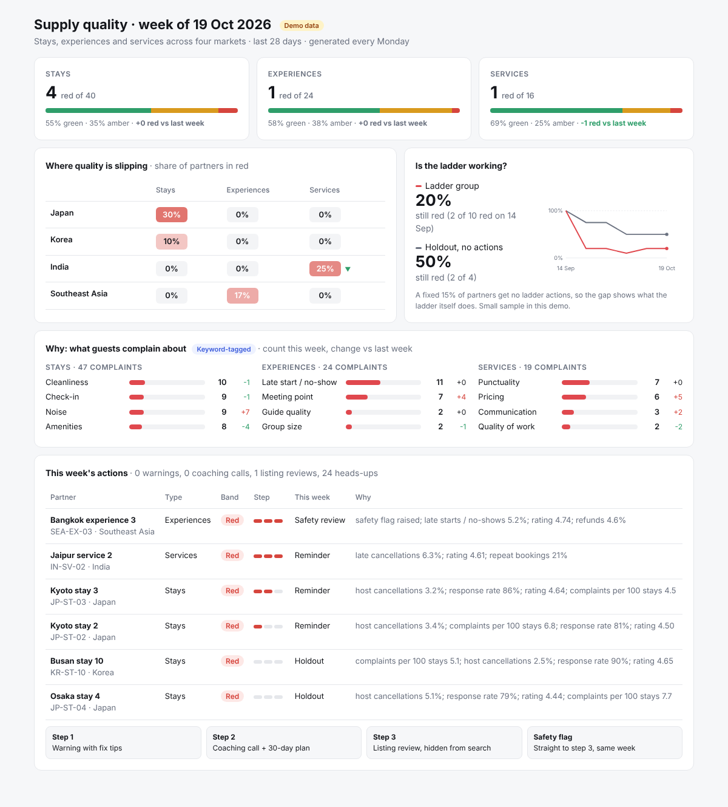

# Supply quality scorecard: stays, experiences and services

**[Open the live scorecard →](https://theyvetteliu-commits.github.io/supply-quality-scorecard/)** Filter by week, market or supply type, click the heat map, and open any partner to see its metrics, history and what guests said.



**Context:** A marketplace is only as good as its weakest supply. One host who cancels, one guide who shows up late, one chef who no-shows, and the guest blames the platform. Quality teams usually find out late, apply different rules each week, and can't tell whether their warnings actually change anything.

* **What I did (and why):** I built a weekly scorecard that rates every partner green, amber or red, using rules made for each supply type. Stays, experiences and services fail guests in different ways, so each has its own metrics and thresholds. Partners who stay red get three escalating steps: a warning with fix tips, then a coaching call, then a listing review. Safety flags skip straight to review. AI tags every guest complaint by theme, so the team sees *why* quality is slipping, not just who. A small comparison group is deliberately left alone, which proves the warnings themselves work and it isn't just luck.
* **Result:** The real version of this framework clearly cut partner-caused cancellations, proved against a control group.

> This repo is a public demo. Every partner, market figure and complaint is invented. The original ran on real operational data that can't be shared; the rules engine and the control-group method are the same design.

## What it does every Monday

```
partner metrics (last 28 days) ──> score by supply type ──> escalation steps ──> partner messages
guest complaints ───────────────> AI theme tagging ──────────────────────────────> weekly report
```

| Output | For whom |
|---|---|
| `index.html` + `site-data.json` | The interactive page: every week, filterable, click-through on every row. Rebuilt by `scripts/build_site.py` at the end of each run. |
| `out/<date>/report.html` | The regional lead: red share by market and supply type, complaint themes, whether the warnings work, this week's actions. |
| `out/<date>/summary.md` | The same read as text, ready for email or Slack. |
| `out/<date>/actions.csv` | Partner support: one ready-to-send message per partner, with fix tips matched to what went wrong. |
| `out/<date>/scores.csv` | Everyone: every partner with band, reasons, step and action. |

## The rules

| Supply type | Red if any of | Min. bookings to score |
|---|---|---|
| **Stays** | host cancellations ≥ 3%, response rate < 80%, rating < 4.5, 5+ complaints per 100 stays | 5 |
| **Experiences** | late starts / no-shows ≥ 8%, rating < 4.6, refunds ≥ 6%, any safety flag | 6 |
| **Services** | late cancellations ≥ 5%, rating < 4.6, repeat bookings < 15% | 4 |

Amber has a softer threshold for each metric. Partners with too few bookings aren't scored, so one bad booking can't put a small host in red.

**Escalation steps** (red only):
1. Warning, with fix tips for what went wrong
2. Coaching call and a 30-day quality plan
3. Listing review, hidden from search until it's done

- The next step only comes if the partner is still red 14+ days later. A weekly reminder goes out in between.
- **A safety flag goes straight to step 3, the same week.** It is never held out.
- Amber gets a heads-up, never a step.
- Everything clears after 8 weeks with no red.

## Do the warnings work? The comparison group

A fixed 15% of partners, picked by a stable hash of their ID, are deliberately left alone: no warnings, no coaching. Safety issues are the exception. The report compares partners who were red at the start: what share is still red now, the ones we warned vs the ones we left alone.

Some partners recover on their own anyway. Without a comparison group, the warnings would take credit for that. This is the same control-group method that proved the real framework.

## Design choices

- **Rules are pure functions** (`scripts/rules.py`), tested on their own (`tests/test_rules.py`).
- **The AI only picks from a fixed theme list** per supply type, so counts stay comparable week to week. Without an API key, or if the call fails, a keyword matcher takes over and the run still finishes.
- **Runs can't double-apply.** A date that already ran is refused unless forced.
- **History holds IDs, steps and dates only.**

## Run it yourself

```bash
python scripts/make_demo_data.py         # six weeks of invented partners and complaints
for f in data/snapshots/*.csv; do
  python scripts/run_weekly.py --date "$(basename "$f" .csv)"
done
python tests/test_rules.py
python -m http.server 8000      # then open http://localhost:8000
```

Add an `ANTHROPIC_API_KEY` repository secret to have Claude tag complaints in the weekly run.
